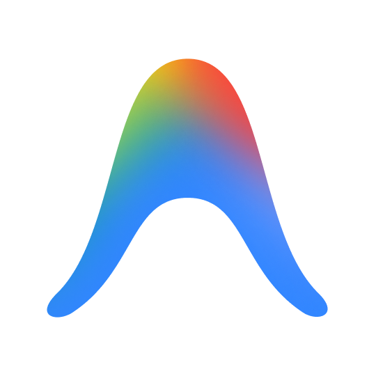

<div align="center">



# AntigravityRPC

**Discord Rich Presence nativo en Rust para Google Antigravity en Windows.**

[](rust/)
[](installer.iss)
[](#-configuración)

</div>

---

## ✨ Qué muestra en Discord

- **Proyecto activo y rama Git** — detecta automáticamente Antigravity 2.0 y Antigravity IDE.
- **Tiempo real acumulado por proyecto** — días activos, horas totales e interacciones reales (`Invertido: 30d | 74h | 413 interacciones`).
- **Estado del agente** — indicador visual de *Trabajando* o *Listo* + botón **Ver repositorio** en repositorios Git.
- **Sin procesos en segundo plano (`--launch`)** — abre y cierra el RPC automáticamente junto con Antigravity.
- **Bandeja del sistema minimalista** — clic izquierdo para configurar en español o inglés (`ES`/`EN`), clic derecho para **Cerrar RPC**.

---

## 📦 Instalación

Ejecuta **`AntigravityRichPresenceSetup.exe`** en Windows 10/11 (x64):

1. Preconfigurado de fábrica listo para conectar con Discord sin cuentas ni claves adicionales.
2. Crea el acceso directo **`Antigravity (con Discord RPC)`** con modo `--launch` para no dejar procesos residentes al cerrar el editor.

---

## 🛠️ Compilar desde el código fuente

Requisitos: **Rust (toolchain GNU)** e **Inno Setup 6**.

```powershell
.\build_installer.ps1
```

Genera:
- `dist\AntigravityRichPresence.exe` — binario nativo optimizado.
- `installer_out\AntigravityRichPresenceSetup.exe` — instalador Windows listo para distribuir.

---

## ⚙️ Configuración

Los ajustes se guardan en `%APPDATA%\AntigravityRichPresence\config.json`:

| Opción | Por defecto | Descripción |
| :--- | :---: | :--- |
| `language` | `es` | Idioma de Discord y de la interfaz (`es` / `en`) |
| `show_project_stats` | `true` | Días activos, horas invertidas e interacciones |
| `show_git_branch` | `true` | Rama Git activa junto al nombre del proyecto |
| `show_agent_status` | `true` | Indicador *Trabajando / Listo* |
| `show_conversation_title` | `false` | Título de la conversación actual dentro de un proyecto |
| `show_repo_button` | `true` | Botón **Ver repositorio** en Discord |

---

<div align="center">

**Telemetría 100% local** · Sin servidores externos · Comunicación directa con `\\.\pipe\discord-ipc-0`

[GitHub](https://github.com/MVP-Savyn) · [YouTube](https://youtube.com/@T0xicArea) · [Discord](https://discord.gg/HJvgmCRpGm)

</div>
